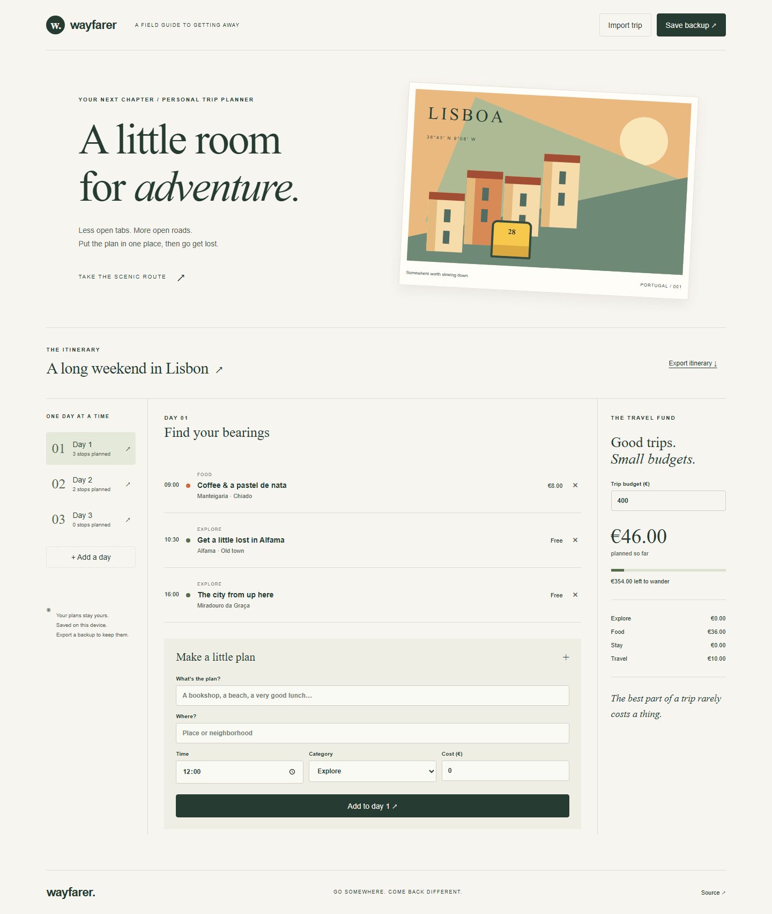

# Wayfarer

A small trip planner for the part of travel that happens before you leave. Build a day-by-day itinerary, keep an eye on spending, and take a plain-text copy with you.

[Live demo](https://goshkaaaa.github.io/wayfarer/) · [Mobile preview](docs/mobile.png) · [Checks](https://github.com/goshkaaaa/wayfarer/actions)



## What it does

- Organize up to 14 days with time-sorted stops, locations, categories, and costs.
- Rename the trip and individual days; remove stops and empty days.
- Compare planned spending with a budget and see category totals.
- Save automatically on this device, with updates between browser tabs.
- Export a Markdown itinerary or a JSON backup; restore a validated backup later.

The Lisbon itinerary is sample data. Prices are illustrative, not travel quotes. All budgets use EUR. There is no account, server database, route optimization, or live map.

## Run locally

Use Node.js 24 LTS and npm.

```sh
npm ci
npm run dev
```

Open `http://localhost:3000`.

```sh
npm run lint
npm test
npx playwright install chromium
npm run test:e2e
npm run build
```

The production build is a static export in `out/`. On GitHub Actions, the base path is `/wayfarer`; local builds use `/`. The repository includes Verify and Deploy demo workflows for GitHub Actions. The current demo is served from a separately published `gh-pages` branch containing a locally verified static build. To enable automatic deployments, select GitHub Actions as the Pages source when Actions is available.

## Inside

Next.js App Router, React, JavaScript, and plain CSS. The layout and metadata stay on the server; the itinerary is an interactive client component. `lib/trip.js` owns validation, totals, and Markdown serialization. `lib/use-trip.js` connects versioned browser storage to React through `useSyncExternalStore`, keeping the server snapshot stable during hydration.

Unit tests cover import limits, invalid times, duplicate IDs, totals, and export. Browser tests exercise persistence, editing, downloads, and invalid imports on desktop and mobile. Accessibility checks use axe against the initial screen.

Browser data can be cleared by your browser. Export a backup for trips you want to keep. Imported files are limited to 1 MB. Google Fonts are optional; local font fallbacks keep the app usable when fonts cannot load.

## Design

Travel notebooks and illustrated postcards: forest green, paper tones, serif headings, and a Lisbon illustration made entirely in CSS. No stock photo or image API dependencies.

MIT license.
